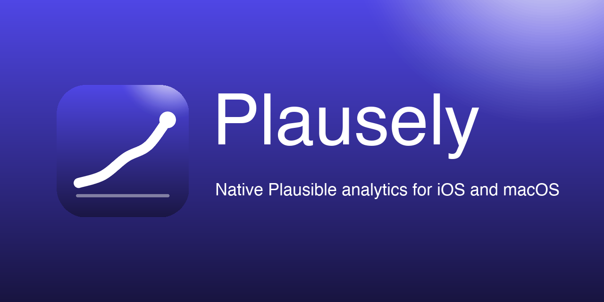
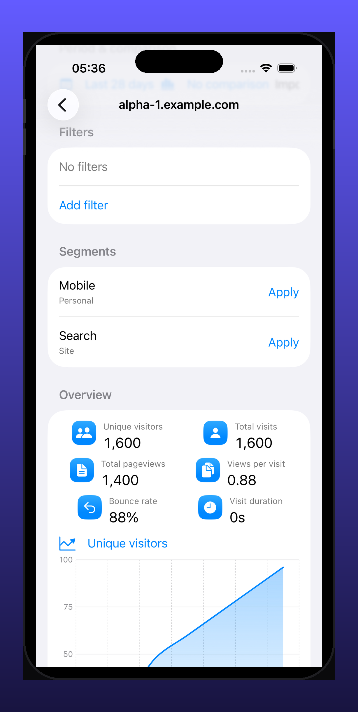
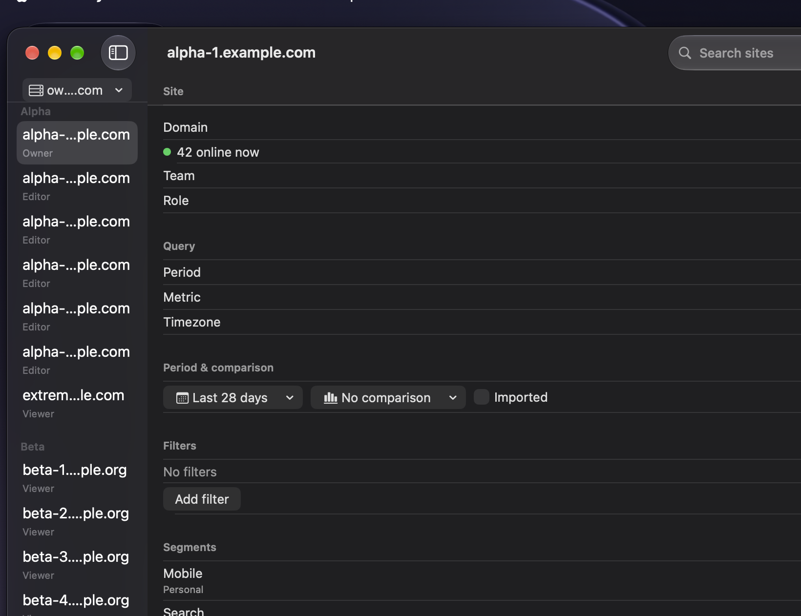

# Plausely



A native Plausible dashboard for iOS and macOS. One Swift codebase, native
SwiftUI shells on both platforms, backed by versioned adapters for the
Plausible Community Edition dashboard API.

## Status: beta

Plausely is a **read-only analytics beta**. Sign in, browse every site you
can access, and inspect overview, acquisition, pages, geography, devices,
goals, properties, realtime, and exports — all values match the web
dashboard exactly (display rounding is the only tolerance).

Not yet in the beta: segment create/edit/delete, password-protected shared
links, Google Search Console setup, and server administration. Those stay in
the browser, linked where appropriate.

## Screenshots

| iOS | macOS |
| --- | --- |
|  |  |

## Requirements

- Plausible Community Edition 3.2.1 server (self-hosted)
- Xcode 16+, iOS 17+, macOS 14+
- Swift 6

## Build

```sh
./scripts/check.sh
```

That single script runs the package tests, both Debug builds, both UI
suites, and both Release builds. macOS builds are ad-hoc signed so
Gatekeeper never prompts; distribution signing is a release concern, not a
build concern.

## Layout

```text
Apps/iOS, Apps/macOS      native scenes, login, live wiring
Packages/PlauselyKit/
  Sources/AnalyticsCore   immutable domain/query/date/value contracts
  Sources/PlausibleClient transport, session, discovery, CE 3.2.1 adapter
  Sources/DashboardUI     models, report views, design system
  Tests/                  contract, adapter, and UI-behavior suites
Tests/                    iOS/macOS UI suites (deterministic mock mode)
```

`AnalyticsCore` imports Foundation only. `PlausibleClient` owns every
secret and every byte of transport. `DashboardUI` never touches the network —
screens receive loader closures, never sessions.

## Privacy

- Session secrets live in the Keychain; account records (never secrets) in
  Application Support.
- Passwords stay in the isolated sign-in webview and are never stored.
- No analytics SDKs, no tracking, no network calls except to the instance
  address you enter.
- Signing out removes the secret, the record, and the cached reports.

## License

MIT — see [LICENSE](LICENSE). Third-party notices in
[THIRD_PARTY_NOTICES](THIRD_PARTY_NOTICES).
