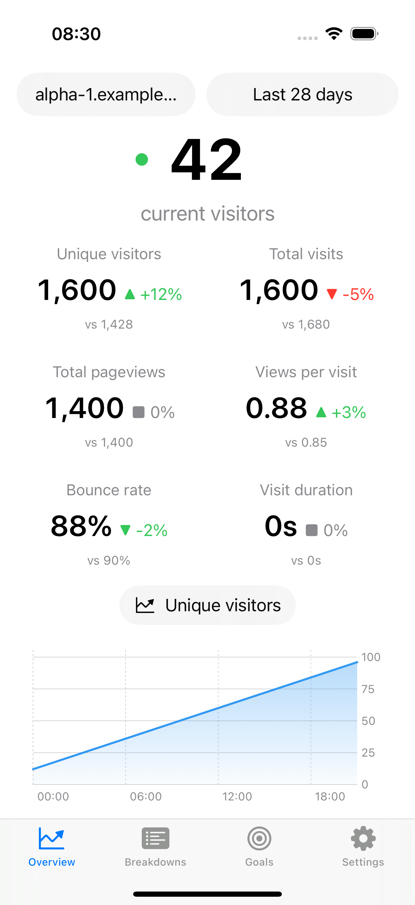
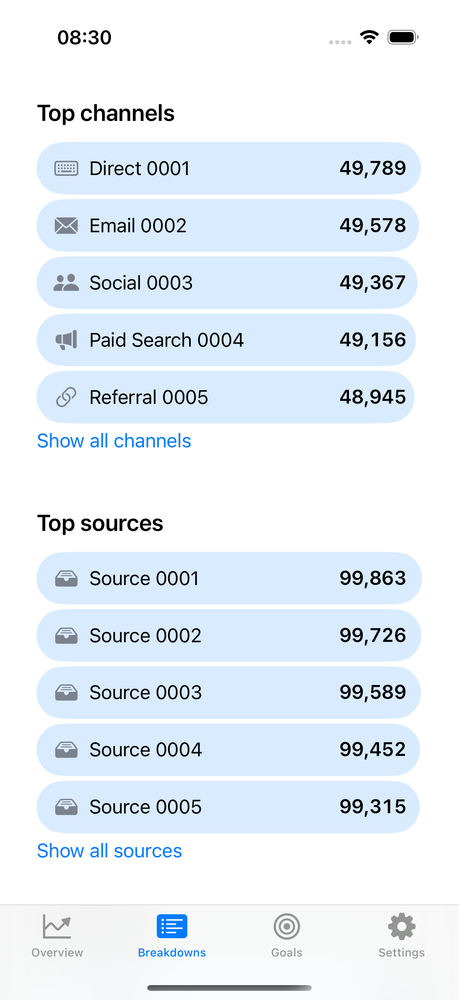
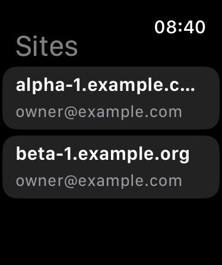
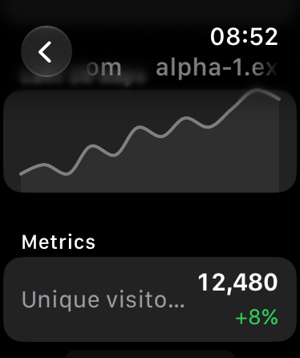

# Plausely


A native Plausible dashboard for iOS, macOS, and watchOS. One Swift
codebase, native SwiftUI shells on every platform, backed by versioned
adapters for the Plausible Community Edition dashboard API.

## Status: beta

Plausely is a **read-only analytics beta**. Sign in, browse every site you
can access, and inspect overview, acquisition, pages, geography, devices,
goals, properties, realtime, and exports — all values match the web
dashboard exactly (display rounding is the only tolerance).

Segment create/edit/delete, password-protected shared-link setup, Google
Search Console setup, and server administration stay in the browser, linked
where appropriate.

## Screenshots

| iOS overview | iOS breakdowns |
| --- | --- |
|  |  |

| macOS | Apple Watch sites | Apple Watch detail |
| --- | --- | --- |
|  |  |  |

All captures render the same deterministic mock instance, so docs shots
match what the UI suites assert.

## What you get

- **Overview** — headline metrics with previous-period deltas, an
  edge-to-edge chart with metric switching, and a realtime hero with a
  live headcount. Period presets plus day and custom-range calendar
  pickers; comparisons with optional weekday alignment.
- **Breakdowns** — channels, sources (with referrer drilldown), search
  terms, UTM hub and families, pages, entry/exit pages, countries,
  regions, cities, browsers, operating systems, and screen sizes. Full
  reports sort, drill, and apply their row as a query filter.
- **Goals** — conversion tables with per-goal funnels plus the custom
  property explorer.
- **Querying** — filters with server suggestions, saved-segment
  shortcuts, imported-data toggle, and per-site interval policies from
  discovery.
- **Exports** — the current query as the server's ZIP (its row caps are
  stated in the sheet).
- **Instances** — email/password sign-in, password-protected shared
  links, multi-instance sidebar with team sections, site pinning, and a
  demo mode for exploring without an account.
- **Personal touches** — onboarding tour, light/dark/system themes,
  six accent colors, Face ID / passcode app lock, and multi-window
  isolation on iPad and Mac.
- **Widgets** — Home Screen and Lock Screen widgets for a chosen site
  and period, with configurable refresh cadence. Widgets respect the
  app lock (they blank while locked) and deep-link back into the site.
- **Apple Watch** — the companion app shows site picker, realtime
  headcount, key metrics with charts, and read-only breakdowns. It
  holds no secrets: every request proxies over WatchConnectivity to
  the iPhone, so numbers match the app exactly and the watch works
  over Bluetooth without its own network.

## Requirements

- Plausible Community Edition 3.2.1 server (self-hosted)
- Xcode 16+, Swift 6
- iOS 17+, macOS 14+, watchOS 11+
- A paired iPhone for the watch app (it proxies through the phone)

## Build

```sh
./scripts/check.sh
```

That single script runs the package tests, all three Debug builds
(iOS, macOS, watchOS), the iOS simulator UI suite, and all three
Release builds. The macOS UI suite is opt-in (`PLAUSLEY_MAC_UI=1`)
because it drives the real screen. macOS steps use the project's
automatic development signing (the app/widget entitlements require it);
distribution signing is a release concern, not a build concern.

```sh
./scripts/screenshots.sh        # iOS + watchOS (simulator-only)
PLAUSLEY_MAC_UI=1 ./scripts/screenshots.sh  # also refreshes macOS
```

## Layout

```text
Apps/iOS, Apps/macOS, Apps/watchOS   native scenes, login, live wiring
Apps/WatchShared                     WatchConnectivity contract (both sides)
Apps/Widgets                         iOS/macOS widgets (incl. Lock Screen)
Packages/PlauselyKit/
  Sources/AnalyticsCore   immutable domain/query/date/value contracts
  Sources/PlausibleClient transport, session, discovery, CE 3.2.1 adapter
  Sources/DashboardUI     models, report views, design system
  Tests/                  contract, adapter, and UI-behavior suites
Tests/                    iOS/macOS UI suites (deterministic mock mode)
```

`AnalyticsCore` imports Foundation only. `PlausibleClient` owns every
secret and every byte of transport. `DashboardUI` never touches the
network — screens receive loader closures, never sessions. The watch
app never touches `PlausibleClient` either: the iPhone answers
`WatchShared` requests through its `LiveHub`, and the watch renders
the pre-formatted replies.

## Privacy

- Session secrets live in the Keychain; account records (never secrets) in
  Application Support.
- Passwords stay in the isolated sign-in webview and are never stored.
- The watch keeps no credentials: it proxies to the phone per request.
- No analytics SDKs, no tracking, no network calls except to the instance
  address you enter.
- Signing out removes the secret, the record, and the cached reports.

## License

MIT — see [LICENSE](LICENSE). Third-party notices in
[THIRD_PARTY_NOTICES](THIRD_PARTY_NOTICES).
